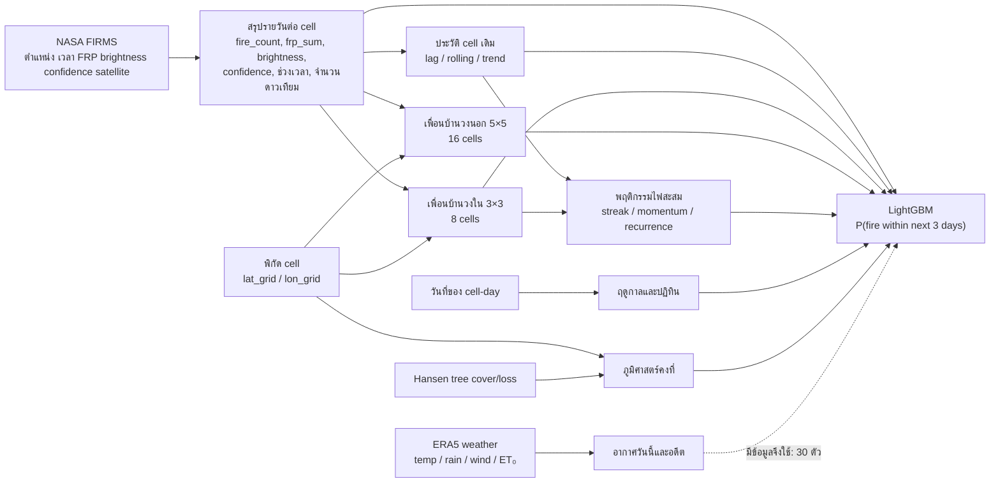

# Variable Network: ความสัมพันธ์ของตัวแปรทั้ง 172 ตัว

เอกสารนี้อธิบาย **สายการสร้างตัวแปร (feature dependency network)** ว่าข้อมูลต้นทางใดถูกแปลงเป็น feature ใด และ feature ชั้นหลังคำนวณต่อจาก feature ใด ก่อนส่งเข้าโมเดลเพื่อทำนาย
`P(เกิด hotspot อย่างน้อย 1 จุดใน cell นี้ภายใน 3 วันข้างหน้า)`

> คำว่า “เกี่ยวข้อง” ใน network นี้หมายถึง **ความสัมพันธ์ตามสูตร feature engineering** ไม่ใช่ค่าสหสัมพันธ์ (correlation) และไม่ใช่เหตุ–ผลทางธรรมชาติ

## ข้อเท็จจริงเรื่องจำนวน feature

| ชุดตัวแปร | จำนวน | สถานะ |
|---|---:|---|
| Core features | 135 | ใช้เสมอเมื่อคอลัมน์ต้นทางมีอยู่ |
| Weather features | 37 | ใช้เมื่อมีข้อมูล ERA5/Open-Meteo ครบใน dataframe |
| **Feature contract รุ่นถัดไป** | **172** | **135 core + 37 weather** |
| โมเดล promoted ปัจจุบัน (`dataset_info.json`) | 164 | contract เดิม 134 core + 30 weather |

ดังนั้น 172 คือชุดตัวแปรตามแบบออกแบบรุ่นถัดไป ส่วนโมเดลที่ใช้งานจริงต้องตรวจจาก
`outputs/metadata/dataset_info.json["features"]` ทุกครั้ง ปัจจุบัน metadata ระบุ
`feature_count = 164` และยังไม่รวม `n_active_satellites`/drought features.

ตัวแปร RADD 12 ตัวและ weather-missing indicators 5 ตัวที่เปิดแบบ optional **ไม่นับรวมใน 172 ตัวนี้**
และไม่ได้อยู่ใน feature contract ของโมเดลล่าสุด

## Network ภาพรวม

## Network ตามสูตร

```mermaid
flowchart TD
    FC[fire_count รายวัน] --> FL[fire_lag_*]
    FC --> FS[fire_sum_*d]
    FC --> AD[active_days_*d]
    FC --> FSTD[fire_std_7d]
    FC --> FCT[fire_count_today]

    FRP[frp_sum / frp_max รายวัน] --> FRPL[frp_lag_*]
    FRP --> FRPS[frp_sum_*d / frp_max_*d]
    FRPL --> FT[frp_trend_*d]

    FS --> ACC[fire_acceleration]
    FS --> MOM[fire_momentum_7_30]
    FS --> F60[fire_count_60d]
    AD --> FREQ[fire_frequency_rate]
    FRPS --> INT[frp_intensity_7d]
    FCT --> PPF[frp_per_fire_today]
    FRP --> PPF

    FC --> NF[neighbor_fire_today / wide_neighbor_fire_today]
    FRP --> NFRP[neighbor_frp_today / wide_neighbor_frp_today]
    NF --> NL[neighbor fire lag / rolling / velocity]
    NFRP --> NRL[neighbor FRP lag / rolling / velocity]

    FC --> DS[days_since_last_fire]
    FC --> GAP[median_fire_gap]
    DS --> NORM[days_since_last_fire_norm]
    GAP --> NORM
    FC --> REC[annual rate / season count / last-year / same-month history]

    DT[date] --> CYC[month / day-of-year / week cyclic]
    DT --> SEASON[burn season / dry season / burn peak / weekday]

    W[weather variable แต่ละชนิด] --> WT[today]
    W --> WL[lag 1, 3, 7 days]
    W --> WR[past mean 3, 7 days]
```

กฎด้านเวลา: rolling ทุกตัวใช้ข้อมูลก่อนวันทำนายด้วย `shift(1)` ก่อน `rolling()`;
lag ใช้ `shift(lag)`; ส่วนตัวแปรชื่อ `_today` ใช้ข้อมูลที่ทราบแล้ว ณ เวลาทำนาย
จึงไม่อ่านอนาคต ส่วน label อ่านเฉพาะช่วง `t+1` ถึง `t+3` และไม่ถูกป้อนกลับเป็น feature

## บัญชีตัวแปรครบ 172 ตัว

### A. ประวัติไฟและ FRP ของ cell เดิม — 68 ตัว

| กลุ่ม | จำนวน | ตัวแปร | สร้างจาก/ความสัมพันธ์ |
|---|---:|---|---|
| Fire lags | 10 | `fire_lag_1`, `fire_lag_2`, `fire_lag_3`, `fire_lag_4`, `fire_lag_5`, `fire_lag_6`, `fire_lag_7`, `fire_lag_14`, `fire_lag_21`, `fire_lag_30` | `fire_count` ของ cell เดิมย้อนหลัง n วัน |
| FRP lags | 10 | `frp_lag_1`, `frp_lag_2`, `frp_lag_3`, `frp_lag_4`, `frp_lag_5`, `frp_lag_6`, `frp_lag_7`, `frp_lag_14`, `frp_lag_21`, `frp_lag_30` | `frp_sum` ของ cell เดิมย้อนหลัง n วัน |
| Rolling 3 วัน | 4 | `fire_sum_3d`, `frp_sum_3d`, `frp_max_3d`, `active_days_3d` | สรุปอดีต 3 วัน ไม่รวมวันนี้ |
| Rolling 5 วัน | 4 | `fire_sum_5d`, `frp_sum_5d`, `frp_max_5d`, `active_days_5d` | สรุปอดีต 5 วัน ไม่รวมวันนี้ |
| Rolling 7 วัน | 4 | `fire_sum_7d`, `frp_sum_7d`, `frp_max_7d`, `active_days_7d` | สรุปอดีต 7 วัน ไม่รวมวันนี้ |
| Rolling 14 วัน | 4 | `fire_sum_14d`, `frp_sum_14d`, `frp_max_14d`, `active_days_14d` | สรุปอดีต 14 วัน ไม่รวมวันนี้ |
| Rolling 21 วัน | 4 | `fire_sum_21d`, `frp_sum_21d`, `frp_max_21d`, `active_days_21d` | สรุปอดีต 21 วัน ไม่รวมวันนี้ |
| Rolling 30 วัน | 4 | `fire_sum_30d`, `frp_sum_30d`, `frp_max_30d`, `active_days_30d` | สรุปอดีต 30 วัน ไม่รวมวันนี้ |
| Rolling 60 วัน | 4 | `fire_sum_60d`, `frp_sum_60d`, `frp_max_60d`, `active_days_60d` | สรุปอดีต 60 วัน ไม่รวมวันนี้ |
| แนวโน้ม/ความผันผวน | 4 | `frp_trend_1d`, `frp_trend_3d`, `frp_trend_7d`, `fire_std_7d` | ผลต่าง FRP lag และ SD ของ fire ในอดีต |
| สัญญาณวันนี้/ยุคข้อมูล | 8 | `fire_count_today`, `frp_sum_today`, `bright_mean_today`, `confidence_mean_today`, `night_fire_count`, `afternoon_fire_count`, `n_satellites_today`, `n_active_satellites` | FIRMS ที่ตรวจพบแล้วในวันฐาน + จำนวนผลิตภัณฑ์ดาวเทียมที่ archive มีถึงวันฐาน |
| ตัวแปรอนุพันธ์ | 8 | `fire_acceleration`, `frp_intensity_7d`, `night_fire_ratio`, `fire_streak_today`, `fire_momentum_7_30`, `frp_per_fire_today`, `fire_count_60d`, `fire_frequency_rate` | อัตราส่วน/ผลต่าง/การนับต่อจาก rolling, lag และ today |

ความสัมพันธ์สำคัญในกลุ่มนี้:

- `fire_acceleration = fire_sum_7d/7 - fire_sum_14d/14`
- `frp_intensity_7d = frp_sum_7d / max(fire_sum_7d, 1)`
- `night_fire_ratio = night_fire_count / max(fire_count_today, 1)`
- `fire_momentum_7_30 = (fire_sum_7d/7) / max(fire_sum_30d/30, 0.01)` และจำกัดช่วง 0–10
- `frp_per_fire_today = frp_sum_today / max(fire_count_today, 1)`
- `fire_count_60d` เป็น alias ของ `fire_sum_60d`
- `fire_frequency_rate = active_days_60d / 60`

### B. การแพร่เชิงพื้นที่ — 43 ตัว

| กลุ่ม | จำนวน | ตัวแปร | สร้างจาก/ความสัมพันธ์ |
|---|---:|---|---|
| วงในวันนี้ | 2 | `neighbor_fire_today`, `neighbor_frp_today` | ผลรวม 8 cell รอบศูนย์กลางในกริด 3×3 |
| วงใน fire lags | 5 | `neighbor_fire_lag_1`, `neighbor_fire_lag_2`, `neighbor_fire_lag_3`, `neighbor_fire_lag_5`, `neighbor_fire_lag_7` | `neighbor_fire_today` ย้อนหลัง |
| วงใน FRP lags | 5 | `neighbor_frp_lag_1`, `neighbor_frp_lag_2`, `neighbor_frp_lag_3`, `neighbor_frp_lag_5`, `neighbor_frp_lag_7` | `neighbor_frp_today` ย้อนหลัง |
| วงใน rolling | 8 | `neighbor_fire_sum_3d`, `neighbor_frp_sum_3d`, `neighbor_fire_sum_5d`, `neighbor_frp_sum_5d`, `neighbor_fire_sum_7d`, `neighbor_frp_sum_7d`, `neighbor_fire_sum_14d`, `neighbor_frp_sum_14d` | ผลรวมเพื่อนบ้านวงในในอดีต |
| วงใน velocity | 2 | `neighbor_fire_velocity_3d`, `neighbor_frp_velocity_3d` | lag 1 ลบ lag 3 |
| วงนอกวันนี้ | 2 | `wide_neighbor_fire_today`, `wide_neighbor_frp_today` | ผลรวม 16 cell วงนอกของกริด 5×5; ไม่รวมวงในและ cell กลาง |
| วงนอก fire lags | 5 | `wide_neighbor_fire_lag_1`, `wide_neighbor_fire_lag_2`, `wide_neighbor_fire_lag_3`, `wide_neighbor_fire_lag_5`, `wide_neighbor_fire_lag_7` | `wide_neighbor_fire_today` ย้อนหลัง |
| วงนอก FRP lags | 5 | `wide_neighbor_frp_lag_1`, `wide_neighbor_frp_lag_2`, `wide_neighbor_frp_lag_3`, `wide_neighbor_frp_lag_5`, `wide_neighbor_frp_lag_7` | `wide_neighbor_frp_today` ย้อนหลัง |
| วงนอก rolling | 8 | `wide_neighbor_fire_sum_3d`, `wide_neighbor_frp_sum_3d`, `wide_neighbor_fire_sum_5d`, `wide_neighbor_frp_sum_5d`, `wide_neighbor_fire_sum_7d`, `wide_neighbor_frp_sum_7d`, `wide_neighbor_fire_sum_14d`, `wide_neighbor_frp_sum_14d` | ผลรวมเพื่อนบ้านวงนอกในอดีต |
| วงนอก velocity | 1 | `wide_neighbor_fire_velocity_3d` | fire lag 1 ลบ fire lag 3 |

### C. ปฏิทิน ฤดูกาล ประวัติซ้ำ และภูมิศาสตร์ — 24 ตัว

| กลุ่ม | จำนวน | ตัวแปร | สร้างจาก/ความสัมพันธ์ |
|---|---:|---|---|
| ปฏิทินแบบวงกลม | 6 | `month_sin`, `month_cos`, `doy_sin`, `doy_cos`, `week_sin`, `week_cos` | แปลงเดือน/วันในปี/สัปดาห์เป็น sin-cos เพื่อให้ปลายปีกับต้นปีอยู่ใกล้กัน |
| ธงเวลาและฤดู | 5 | `is_burn_season`, `is_dry_season`, `days_from_burn_peak`, `day_of_week`, `is_weekend` | คำนวณจากวันที่เท่านั้น |
| ประวัติสะสม/การเกิดซ้ำ | 9 | `distance_to_nearest_city_km`, `fire_days_per_year_so_far`, `days_since_last_fire`, `season_fire_count_so_far`, `days_into_burn_season`, `median_fire_gap`, `days_since_last_fire_norm`, `same_week_fire_last_year`, `fire_count_same_month_hist` | พิกัด + ประวัติไฟก่อนวันฐาน + วันที่ |
| พืชพรรณ | 2 | `tree_cover_pct_2000`, `tree_loss_pct_recent` | Hansen tree cover/loss ที่ผูกกับ cell |
| ตำแหน่ง | 2 | `lat_grid`, `lon_grid` | พิกัดศูนย์กลาง cell ขนาด 0.1° |

ความสัมพันธ์สำคัญในกลุ่มนี้:

- `days_since_last_fire_norm = days_since_last_fire / max(median_fire_gap, 1)` และจำกัดไม่เกิน 10
- `same_week_fire_last_year` ตรวจ cell เดิมในช่วงวันของปี ±7 วันของปีก่อน
- `fire_count_same_month_hist` ใช้ค่าเฉลี่ยเดือนเดียวกันจากปีก่อนหน้าเท่านั้น
- `distance_to_nearest_city_km`, vegetation และพิกัดเป็นตัวแปรคงที่ต่อ cell; ที่เหลือเปลี่ยนตามวัน

### D. อากาศ — 37 ตัว

ตัวแปรอากาศต้นทาง 5 ชนิด ได้แก่ `temp_max`, `temp_min`, `precip_sum`, `wind_max`, `et0`.
แต่ละชนิดแตกเป็น 6 feature: วันนี้ 1 ตัว, lag 3 ตัว และ rolling mean 2 ตัว
(รวม `5 × 6 = 30`) และ drought feature แบบ causal อีก 7 ตัว:
`consecutive_dry_days`, `precip_sum_{30,60,90}d`, และ
`precip_deficit_{30,60,90}d` (ผลบวกของ ET₀ สะสมลบฝนสะสม).

| ต้นทาง | Feature 6 ตัว | ความหมาย |
|---|---|---|
| `temp_max` | `temp_max_today`, `temp_max_lag_1`, `temp_max_lag_3`, `temp_max_lag_7`, `temp_max_mean_3d`, `temp_max_mean_7d` | อุณหภูมิสูงสุดวันนี้/ย้อนหลัง/ค่าเฉลี่ยอดีต |
| `temp_min` | `temp_min_today`, `temp_min_lag_1`, `temp_min_lag_3`, `temp_min_lag_7`, `temp_min_mean_3d`, `temp_min_mean_7d` | อุณหภูมิต่ำสุดวันนี้/ย้อนหลัง/ค่าเฉลี่ยอดีต |
| `precip_sum` | `precip_sum_today`, `precip_sum_lag_1`, `precip_sum_lag_3`, `precip_sum_lag_7`, `precip_sum_mean_3d`, `precip_sum_mean_7d` | ฝนรวมวันนี้/ย้อนหลัง/ค่าเฉลี่ยอดีต |
| `wind_max` | `wind_max_today`, `wind_max_lag_1`, `wind_max_lag_3`, `wind_max_lag_7`, `wind_max_mean_3d`, `wind_max_mean_7d` | ลมสูงสุดวันนี้/ย้อนหลัง/ค่าเฉลี่ยอดีต |
| `et0` | `et0_today`, `et0_lag_1`, `et0_lag_3`, `et0_lag_7`, `et0_mean_3d`, `et0_mean_7d` | การคายระเหยอ้างอิงวันนี้/ย้อนหลัง/ค่าเฉลี่ยอดีต |

## ตรวจยอด

| หมวด | จำนวน |
|---|---:|
| A. ประวัติไฟและ FRP ของ cell เดิม | 68 |
| B. การแพร่เชิงพื้นที่ | 43 |
| C. ปฏิทิน ประวัติซ้ำ และภูมิศาสตร์ | 24 |
| D. อากาศ | 37 |
| **รวม** | **172** |

## วิธีอ่าน network ให้ถูกต้อง

1. เส้นเชื่อมบอกว่า feature ปลายทาง “คำนวณจาก” ตัวแปรต้นทาง ไม่ได้บอกว่าตัวแปรหนึ่งเป็นสาเหตุให้ไฟเกิด
2. Feature ที่มาจากฐานเดียวกันย่อมซ้ำข้อมูลบางส่วน เช่น `fire_sum_60d` กับ `fire_count_60d` เท่ากัน และ rolling 7 วันซ้อนอยู่ใน rolling 14/30/60 วัน
3. ตัวแปร sin/cos ต้องอ่านเป็นคู่ เช่น `doy_sin` + `doy_cos`; อ่านตัวเดียวจะตีความตำแหน่งในวงรอบฤดูกาลไม่ครบ
4. ความสำคัญจริงของตัวแปรต้องอ่านจาก `feature_importance_top` หรือวิเคราะห์ SHAP ของโมเดลรุ่นเดียวกัน ไม่ควรอนุมานจากจำนวนเส้นใน network
5. Weather เป็นเส้นแบบ optional: หากไม่มีข้อมูลตอน train โมเดลจะไม่มีทั้ง 37 ตัว ไม่ใช่ใส่ชื่อไว้แล้วให้โมเดลเดาเอง
